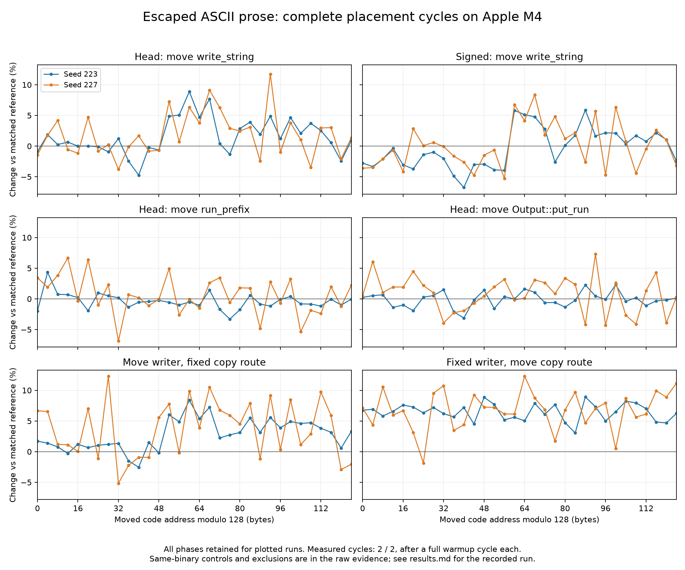

# VIBE-201: the repeatable phase follows `write_string`

Moving only `write_string` reproduces the dominant escape-heavy 128-byte phase
pattern from the earlier whole-code sweep. This function contains the inlined
first-block `prefix` test and the ordinary-run append/escape loop. Moving
`run_prefix` or `Output::put_run` independently does not reproduce a component
of comparable size in these experiments. No runtime optimization is proposed.

The controlled result is at **function-placement granularity**, including the
linker's necessary call relocations. It does not identify an individual branch,
instruction-cache event, predictor conflict, stall, or heap-data alignment as
the microarchitectural cause.

## Executed path and controls

The unchanged 500,016-byte payload is entirely ASCII. It has 47,415 ordinary
runs; 38,428 are shorter than 16 bytes. Source inspection shows these runs
take `write_string`'s ASCII path instead of `write_text`. Native sampling sees
`write_string`, the system copy routine, `run_prefix` and `put_run`; the copy
routine dominates that trace. Sampling was separate from timed cohorts and
overlapped linking, so its counts are used for path identification, not
unbiased attribution of execution percentages.

Disassembly confirms that `prefix` has no standalone symbol. The ordinary-run
copy is a `BL` to the `_memcpy` import at `write_string + 0x6e0` in head
(the corresponding return is at `+0x6e4`). The native system resolves copying
to `_platform_memmove` in the sampled process. The signed comparator changes
instructions in the inlined prefix as well as in `run_prefix`; escaping ASCII
does not mean the shared classifier is unused.

Each isolated sweep moves its selected function by 4, 8, ..., 128 bytes while
auditing that every other original symbol stays fixed. The selected function
is initially reordered to the front; full-cohort averages versus the as-built
reference also include that reorder and must not be called optimization gains.

In seed 211, head's isolated writer phase profile correlates **0.895** with the
preserved whole-code profile when aligned by the writer's actual address modulo
128. The first independent confirmation, seed 223, gives **0.884** for head
and **0.843** for signed against their respective parent profiles. These are
descriptive correlations of all 32 phase means, not significance tests. The
parent profiles and new raw data are both retained in the archive.
The parent writer starts at `0x1003ed1f4` in head and `0x1003ed13c` in signed;
add each recorded front pad before reducing modulo 128.

## Copy-route intervention

The ordinary-run copy is a plausible contributor because it is hot, but a
targeted intervention does not transfer the broad pattern to the copy-return
site alone:

- Moving the writer while anchoring its copy call/return route at one address
  retains the broad phase component.
- Keeping the writer fixed and moving only that two-instruction route does
  not reproduce the broad component at comparable amplitude.

The intervention replaces exactly three instruction words: the original call,
the island call and its return branch. Every other text instruction and all
symbol addresses are checked against the unpatched source executable. The
original import binding and executable signature are checked independently.
All 64 patched executables preserve complete output and accounting.

This weakens a simple explanation based solely on the copy call/return PC in
this topology. The added branches also change control-flow history, so this
does **not** rule out interactions with copying, branch prediction or the
surrounding writer loop. The diagnostic routes add overhead and are not fixes.

## Measurements and noise

Every phase is retained in [the phase tables](phases.md) and
[raw evidence](evidence.json.gz). The chart shows mean paired changes against
the same as-built reference, separately for each confirmation seed.

The fitted 128-byte component's peak-to-trough amplitude is:

| Moved code / control | Seed 211 | Seed 223 | Seed 227 |
|---|---:|---:|---:|
| Head writer | 5.30 pp | 4.48 pp | 4.32 pp |
| Signed writer | — | 6.12 pp | 4.51 pp |
| run_prefix | 0.84 pp | 1.31 pp | 1.71 pp |
| put_run | 0.60 pp | 0.94 pp | 0.13 pp |
| Writer, fixed copy route | — | 4.80 pp | 4.18 pp |
| Copy route, fixed writer | — | 0.32 pp | 0.53 pp |
| Same-binary control | 0.64 pp | 1.76 pp | 0.54 pp |

Mean paired same-binary controls are **+0.29%** (seed 211), **+0.88%** (seed 223), **+0.28%** (seed 227).

The fitted component uses **all 32 phases**, with no fast/slow subset chosen:
for each phase, average its paired percentage changes to the reference; fit
`a*cos(2πk/32) + b*sin(2πk/32)`; report `2*sqrt(a*a + b*b)` in percentage points.
It is a descriptive first-harmonic peak-to-trough amplitude, not the raw range,
a confidence interval, an optimization gain, or evidence of a particular cache
line size. This summary was added after inspecting the phase curves; the
original per-phase measurements remain available for other analyses.

Seed 227 had substantial drift: its reference averaged 687.75 µs in the first
measured cycle and 739.61 µs in the second. Background Spotlight indexing was
observed, but this experiment does not establish its contribution. The run is
retained. The sampled load cutoff
does not eliminate scheduling/frequency noise, as the same-binary controls
also demonstrate.

An intervening seed-229 run overlapped the instruction audit in its final
cycle because that audit was started before the timing process exited. The
entire run is excluded from confirmation inference, with its full samples and
protocol-deviation note retained. Its optional replacement, seed 233, was
stopped incomplete under sustained load above the cutoff, with Spotlight
indexing dominating CPU use. Its entire attempt is also retained separately
and excluded, including completed cycles. No partial cycle is used to strengthen
the finding. The complete independent experiments are seeds 211, 223 and 227.

All **193 unique executables** pass complete-output comparison and accounting:
output digest `72a39c6cf2874486`, **142,308 steps**, **2,124,742 peak tracked bytes**,
and **1,000,186 retained tracked bytes**. All **320 accepted groups** in the three
complete valid experiments (224 measured, 96 warmup; 2,176 timed invocations)
match these signatures. No groups in those experiments were rejected; their
maximum sampled load was **3.10**. Excluded attempts and their rejected
groups remain in the archive. The independent symbol/instruction audit passes
for all 128 isolated placements and all 64 patched copy routes.

## Scope

This locates the largest reproducible component in the executed writer's code
placement and separates it from the unused `write_text` placement control.
The isolated `run_prefix`/`put_run` and copy-route results bound alternatives;
they do not prove those functions are free of smaller layout effects.

HTML-heavy prose is not measured here. Its earlier within-binary variation
remains separate evidence and is not explained by the ASCII escape result.
No pad is chosen for shipping, and no general signed-versus-head escape speedup
or regression is claimed from these linked executables.

See [methods and reproduction](README.md). Source code, build flags and
production behavior are unchanged by this evidence-only change.
